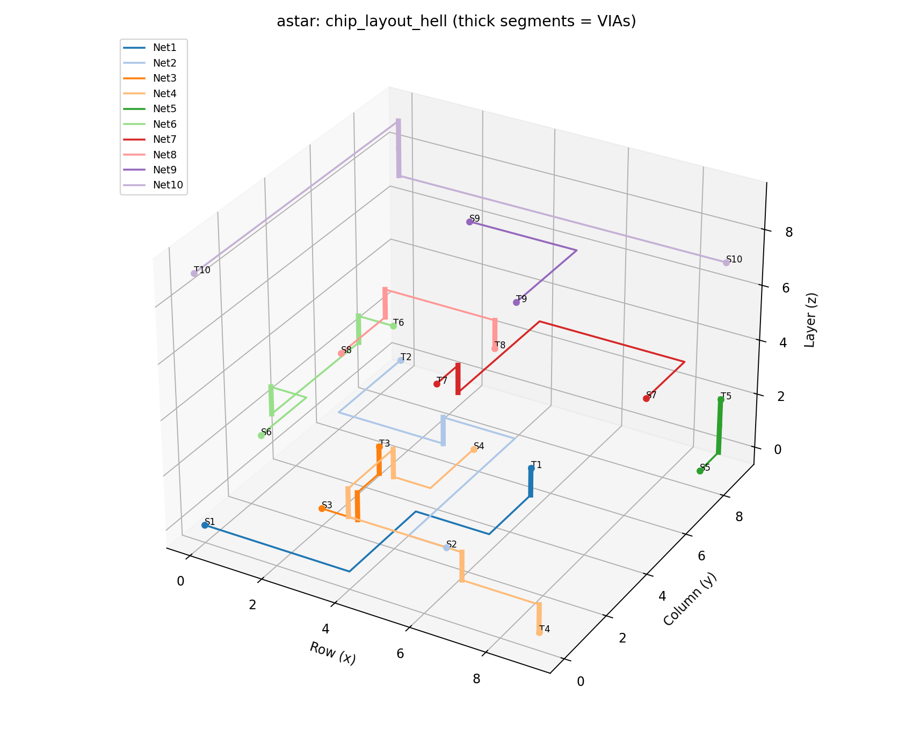

# Independent Technical Project — VLSI Routing and Algorithm Evaluation

A C++17 project exploring how graph search connects circuit terminals across
multiple routing layers while avoiding obstacles and conflicts. The simplified
grid model connects algorithm implementation with concepts from semiconductor
interconnect design. It is an undergraduate educational project, not an industrial
EDA tool or a complete physical-design workflow.

The project implements established A*, Dijkstra, BFS, and rip-up/reroute methods.
Its engineering work includes explicit constraints, independent validation,
deterministic testing, visualization, and reproducible comparisons. No new
shortest-path algorithm or global routing optimality is claimed.

## Routing model

- **A*** and **Dijkstra** use the same weighted costs; A* adds a consistent
  Manhattan heuristic. **BFS** minimizes unweighted graph-edge count.
- Planar edges cost 1; adjacent-layer transitions (VIAs) cost 6. Occupied cells
  and past conflicts add temporary search penalties.
- All required nets must have legal, nonempty, mutually disjoint paths. A low-cost
  but conflicting collection of paths is an unsuccessful result.
- Numeric net order is the default. Optional reverse order changes scheduling
  while preserving net identities. Full rip-up/reroute retains congestion history.
  BFS stops after one pass because these weights cannot change its paths.

## Build and run

Requires a C++17 compiler, Make, and Python 3.10+. No third-party C++ dependencies.
Run from the repository root:

```sh
make
./router --input data/chip_layout_hell.txt --algorithm astar --output build/route.json --max-iterations 10
./router --help
```

Algorithms: `astar`, `dijkstra`, `bfs`. Optional `--net-order numeric|reverse`;
`--max-iterations` bounds total passes. Defaults remain the hell layout, A*,
numeric order, ten passes, and `output.json`.

Exit codes: **0** validated complete routing, **2** incomplete/conflicted routing
with diagnostic JSON, **1** invalid input/options or I/O failure. JSON distinguishes
termination reasons, locally valid candidates, globally valid nets, and conflicts.
Input/output aliases, including symlinks and hardlinks, are rejected. A distinct
existing output file can still be replaced; writes are not transactional.

Input headers are `rows cols` or `layers rows cols`. Each nonblank row contains
exactly `cols` tokens: `.` empty, `#` obstacle, `S<number>` source, `T<number>`
target. Duplicate/missing pins and malformed dimensions are rejected. Net IDs may
have gaps. The six original datasets are unchanged by the current audit; earlier
row repairs are documented in [the original audit](docs/AUDIT.md).

## Test and visualize

Core correctness uses the Python standard library. Plotly/Matplotlib are optional
for core tests; install them for the complete local gate and figures:

```sh
python3 -m venv .venv
.venv/bin/python -m pip install -r requirements.txt
make clean
make test PYTHON=.venv/bin/python
make sanitize
python3 tests/smoke_cli.py
python3 benchmarks/verify_evidence.py
.venv/bin/python visualize.py --input output.json --html build/routing.html --no-show
```

The latest local verification passed **17 C++ groups, 16 Python tests, and
ASan/UBSan**, with no skips in the configured virtualenv. Plain `make test` passed
15 Python tests and skipped the optional Plotly test. Coverage includes 200
seeded Bellman–Ford oracle comparisons, every original fixture, reverse order,
malformed API layouts, arithmetic bounds, invalid JSON, timeouts, and evidence
preservation. See [the engineering audit](docs/ENGINEERING_AUDIT.md) and
[recorded commands/exit codes](docs/verification/final.json).

[EDA validation run #1](https://github.com/Vinh-Duy/EDA_Routing_Algorithm/actions/runs/38993901220)
**passed on October 17, 2026, for commit `bef67d0`**. All four Ubuntu 24.04 jobs
succeeded: GCC and Clang correctness, sanitizers, and headless Plotly visualization.
The [workflow](.github/workflows/eda-validation.yml) runs a small benchmark smoke
check, not the full archived experiments. This hosted CI result is separate from
the earlier local test counts and benchmark measurements below; it does not
remeasure their timings or establish universal portability or performance.



The representative image and `output.json` come from earlier verified runs;
current tests confirm that their route/schema conventions remain supported.

## Evidence and reproduction

The three archived suites each contain **840 measured runs**, with 20 repetitions
per dataset/algorithm pair. They describe distinct source snapshots:

- [Original default-pass results](benchmarks/RESULTS.md) and
  [one-pass results](benchmarks/single_pass/RESULTS.md): commit `62022a0`.
- [BFS early-stop results](benchmarks/early_stop/RESULTS.md): the earlier local
  source snapshot, reconstructable using [this saved patch](docs/verification/early-stop-source.patch)
  on `62022a0`. These are historical measurements, not timings of today's source.

The new [robustness appendix](benchmarks/ROBUSTNESS.md) records **150 measured
runs** on five new obstacle seeds, three algorithms, two net orders, and five
repetitions per combination. A* and Dijkstra succeed on all five inputs under
either order; BFS fails all five because conflicts remain. Each input has 12 nets.
On seed 20261018, A* physical cost changes from 874 to 838 when reversed; on seed
20261021 it changes from 858 to 902. Neither order is universally better.

For a new full-suite run, choose a fresh result directory:

```sh
python3 benchmarks/run_benchmarks.py --repetitions 20 --results-dir build/reproduction
.venv/bin/python benchmarks/plot_results.py --csv build/reproduction/results.csv --output-dir build/reproduction/figures --format png
python3 benchmarks/verify_evidence.py --suite build/reproduction
```

The runner refuses to overwrite recorded CSV/metadata, independently validates
outputs, retains failures, checks repeatability, and records source/input/binary
hashes plus the compiler invocation associated with a Make-built executable.
Unrecorded external binaries explicitly have unavailable build provenance.
For plotting an archived CSV, use both a fresh `--output-dir` and `--report`;
plot regeneration writes those destinations. Additional-seed and order commands
are in [ROBUSTNESS.md](benchmarks/ROBUSTNESS.md). Avoid concurrent heavy work when
measuring runtime.

## Engineering observations and limitations

BFS and weighted search optimize different objectives. A* and Dijkstra optimize
a single net in a fixed context, but earlier choices change later nets' occupancy.
Fewer expanded nodes need not mean less runtime: allocation, queues, validation,
cache behavior, and system load also matter. Physical cost is planar wirelength
plus six times VIA count; historical search cost is a separate quantity.

This model has two-pin nets and unit-capacity cells. It does not model wire
width/spacing, process rules, timing, parasitics, preferred layer directions, or
manufacturability. Rerouting can cycle or exhaust its budget. Five new synthetic
obstacle layouts and measurements on one machine do not establish statistical or
industrial superiority. Future work includes more layouts and pin placements,
selective rip-up, parameter sensitivity, and geometric constraints.

## Repository guide

`src/` contains strategies, layout parsing, routing, validation, and JSON output;
`tests/` contains C++/Python checks and the CI smoke gate. `benchmarks/` holds
scripts and preserved experiments; `docs/verification/` holds audit logs and
preservation hashes. `visualize.py` displays ordered routes and VIA transitions.

Further reading: [technical report](benchmarks/REPORT.md),
[current audit](docs/ENGINEERING_AUDIT.md),
[admissions summary and interview questions](docs/PROJECT_SUMMARY.md).
