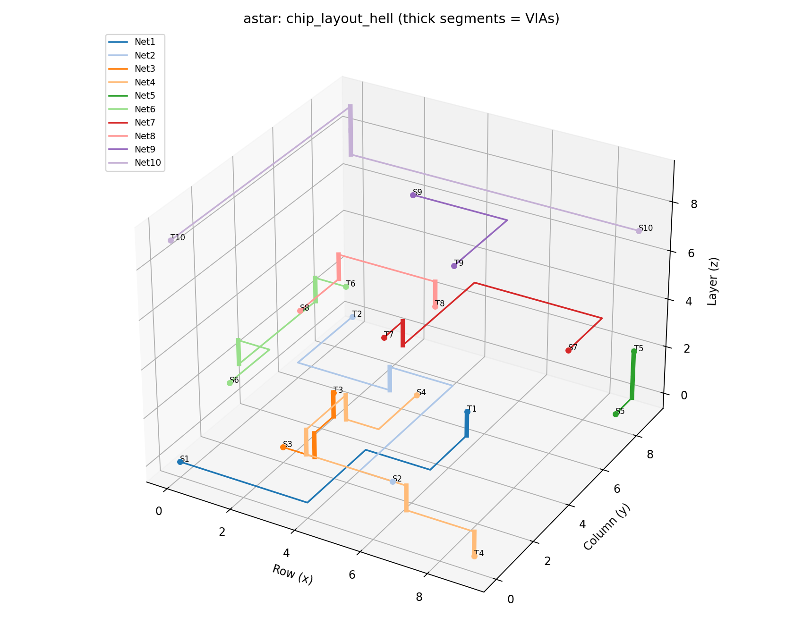

# Independent Technical Project — VLSI Routing and Algorithm Evaluation

A C++17 project exploring how graph search connects circuit terminals across
multiple routing layers while avoiding obstacles and conflicts. The simplified
grid model connects algorithm implementation with concepts from semiconductor
interconnect design. It is an undergraduate educational project, not an industrial
EDA tool or a complete physical-design workflow.

The project implements established A*, Dijkstra, BFS, and rip-up/reroute methods.
Its engineering work includes explicit constraints, independent validation,
deterministic testing, visualization, and reproducible comparisons. No new
shortest-path algorithm or global routing optimality is claimed.

## Routing model

- **A*** and **Dijkstra** use the same weighted costs; A* adds a consistent
  Manhattan heuristic. **BFS** minimizes unweighted graph-edge count.
- Planar edges cost 1; adjacent-layer transitions (VIAs) cost 6. Occupied cells
  and past conflicts add temporary search penalties.
- A net may have the legacy S/T pair or additional P terminals. Every terminal
  must connect into a legal, mutually disjoint route tree. Partial trees and
  cross-net conflicts are unsuccessful results.
- Numeric net order is the default. Optional reverse order changes scheduling
  while preserving net identities. Full rip-up/reroute retains congestion history.
  BFS stops after one pass because these weights cannot change its paths.

## Build and run

Requires a C++17 compiler, Make, and Python 3.10+. No third-party C++ dependencies.
Run from the repository root:

```sh
make
./router --input data/chip_layout_hell.txt --algorithm astar --output build/route.json --max-iterations 10
./router --input benchmarks/steiner/layouts/branch_sharing_saves_cost.txt --terminal-order nearest --output build/nearest.json
./router --help
```

Algorithms: `astar`, `dijkstra`, `bfs`. Optional `--net-order numeric|reverse`
controls cross-net scheduling; `--terminal-order input|nearest` controls
multi-terminal attachment. Input order remains the default. `--max-iterations`
bounds total passes. Defaults remain the hell layout, A*, numeric net order,
input terminal order, ten passes, and `output.json`.

Exit codes: **0** validated complete routing, **2** incomplete/conflicted routing
with diagnostic JSON, **1** invalid input/options or I/O failure. JSON distinguishes
termination reasons, locally valid candidates, globally valid nets, and conflicts.
Input/output aliases, including symlinks and hardlinks, are rejected. A distinct
existing output file can still be replaced; writes are not transactional.

Input headers are `rows cols` or `layers rows cols`. Each nonblank row contains
exactly `cols` tokens: `.` empty, `#` obstacle, `S<number>` source, `T<number>`
target, and zero or more `P<number>` additional terminals. P tokens repeat the
owning net ID; each P requires a matching S/T pair. Duplicate S/T pins and
malformed dimensions are rejected. Net IDs may have gaps. Two-terminal JSON
keeps its ordered `path`; a multi-terminal net returns a deduplicated `tree_edges`
list and all terminals. The six original datasets are unchanged by the current
audit; earlier row repairs are documented in [the original audit](docs/AUDIT.md).

Multi-terminal routing grows a tree deterministically. The default attaches T
and then P terminals in input order; optional `--terminal-order nearest` selects
the closest reachable terminal by weighted Dijkstra distance before routing it
with the requested algorithm. Both are incremental heuristics, not an exact
Steiner solver. Its only geometric capacity rule is exclusive grid-cell
ownership across nets; shared cells and edges within one net are allowed.

The separate [single-net exact Steiner reference and paired terminal-order
evaluation](docs/STEINER_EVALUATION.md) uses Dreyfus-Wagner subset dynamic
programming, reconstructs a weighted tree, and is independently cross-checked
against tiny exhaustive edge-subset instances. Its limits and infeasible/
resource-limited statuses are explicit. It is an evaluation oracle, not a
production routing algorithm. The older `benchmarks/exact_oracle.py` instead
solves tiny multi-net vertex-disjoint two-pin path instances; it is not a
multi-terminal Steiner oracle.

## Test and visualize

Core correctness uses the Python standard library. Plotly/Matplotlib are optional
for core tests; install them for the complete local gate and figures:

```sh
python3 -m venv .venv
.venv/bin/python -m pip install -r requirements.txt
make clean
make test PYTHON=.venv/bin/python
make sanitize
python3 tests/smoke_cli.py
python3 benchmarks/verify_evidence.py
.venv/bin/python visualize.py --input output.json --html build/routing.html --no-show
```

The October 18 local verification passed **17 C++ groups, 23 Python tests, and
ASan/UBSan**, with no skips in the configured virtualenv. The earlier October 17
gate passed 16 Python tests (15 plus an optional Plotly skip without dependencies).
Coverage includes 200 seeded Bellman–Ford oracle comparisons, every original fixture, reverse order,
malformed API layouts, arithmetic bounds, invalid JSON, timeouts, and evidence
preservation, plus 60 tiny multi-net cases checked against an independent exhaustive
edge-subset reference. The current suite also checks the single-net Steiner DP
against an independent brute-force edge-subset enumerator on 50 seeded graphs,
and verifies nearest-terminal selection, tie-breaking, unreachable candidates,
and the zero-edge tree-validator boundary. See [the engineering audit](docs/ENGINEERING_AUDIT.md),
[earlier local records](docs/verification/final.json), and
[October 18 commands/exit codes](docs/verification/exact/checks.json).

[EDA validation run #1](https://github.com/Vinh-Duy/EDA_Routing_Algorithm/actions/runs/38993901220)
**passed on October 17, 2026, for commit `bef67d0`**. All four Ubuntu 24.04 jobs
succeeded: GCC and Clang correctness, sanitizers, and headless Plotly visualization.
The [workflow](.github/workflows/eda-validation.yml) runs a small benchmark smoke
check, not the full archived experiments. This hosted CI result is separate from
the local verification records and benchmark measurements below; it does not
remeasure their timings or establish universal portability or performance.
That run predates the new exact-reference tests; their hosted execution is not yet verified.
The current workflow's `make test` and CLI smoke gate now include multi-terminal
fixtures and the tiny edge-subset reference. The updated workflow itself has not
yet been run by GitHub Actions.
The November 1 local run additionally covers the Dreyfus-Wagner oracle and
nearest-terminal regressions: `make test` passed 23 C++ groups and 33 Python
tests (2 optional Plotly skips), and `python3 tests/smoke_cli.py` passed 24
routing cases plus 30 benchmark observations with no execution or validation
errors. The historical evidence verifier also passed for all three 840-row
benchmark suites and confirmed the preserved measurements, figures, and
original datasets are unchanged. These are local results, not a hosted CI run.



The representative image and `output.json` come from earlier verified runs;
current tests confirm that their route/schema conventions remain supported.

## Evidence and reproduction

The three archived suites each contain **840 measured runs**, with 20 repetitions
per dataset/algorithm pair. They describe distinct source snapshots:

- [Original default-pass results](benchmarks/RESULTS.md) and
  [one-pass results](benchmarks/single_pass/RESULTS.md): commit `62022a0`.
- [BFS early-stop results](benchmarks/early_stop/RESULTS.md): the earlier local
  source snapshot, reconstructable using [this saved patch](docs/verification/early-stop-source.patch)
  on `62022a0`. These are historical measurements, not timings of today's source.

The new [robustness appendix](benchmarks/ROBUSTNESS.md) records **150 measured
runs** on five new obstacle seeds, three algorithms, two net orders, and five
repetitions per combination. A* and Dijkstra succeed on all five inputs under
either order; BFS fails all five because conflicts remain. Each input has 12 nets.
On seed 20261018, A* physical cost changes from 874 to 838 when reversed; on seed
20261021 it changes from 858 to 902. Neither order is universally better.

The separate [tiny exact-reference study](docs/EXACT_ROUTING.md) checks global
feasibility and optimal physical cost on six selected examples. It distinguishes
proven infeasibility from heuristic failure and quantifies feasible solution gaps.
On one example, numeric A*/Dijkstra cost 11 while the exact optimum is 7; reverse
order attains 7. These are explanatory counterexamples, not performance statistics.
The exhaustive tool is capped at 16 traversable cells and four nets; budget
exhaustion returns `unknown` rather than claiming infeasibility.

The new [paired single-net study](benchmarks/steiner/experiment_20261101_paired/RESULTS.md)
compares input-order and nearest-next-terminal growth on six identical fixed
layouts using A*, one pass, and the same complete terminal sets. Five cases are
oracle-feasible and both strategies attain each exact optimum; both fail the one
proven-infeasible case. There is no physical-cost improvement in this corpus.
Nearest performs more searches and expands more nodes on each feasible case;
the per-case timing differences are small local measurements and are not
generalizable. Raw outputs and input/source/build hashes are retained.

The follow-up [held-out study](benchmarks/steiner/experiment_20261101_heldout_final/evaluation/RESULTS.md)
evaluates 60 generated oracle-feasible cases (3–6 terminals, 1–3 layers) and 12
proven-infeasible controls, using 11 repeated runs per strategy with one warm-up.
Both methods routed all feasible cases. Nearest reduced the relative gap on 20,
tied on 36, and increased it on 4; its mean paired gap delta was -0.0488
(layout-bootstrap 95% interval [-0.0765, -0.0241]). It also expanded a mean
1,161 nodes versus 77.6 for input order. This favors nearest on this synthetic
corpus for solution quality, but not search effort; it is not an industrial
performance claim. A first pilot was superseded after detecting a confound
between obstacle mode and spatial class; the corrected run uses new seeds and
orthogonal factor assignment. Both runs and their provenance are retained. The
final generator, development split, frozen protocol, full seed and rejection
manifest, per-instance results, raw outputs, and provenance are preserved in the
linked experiment directory. The graph equivalence check and limitations are
documented in [the evaluation design](docs/STEINER_EVALUATION.md).

For a new full-suite run, choose a fresh result directory:

```sh
python3 benchmarks/run_benchmarks.py --repetitions 20 --results-dir build/reproduction
.venv/bin/python benchmarks/plot_results.py --csv build/reproduction/results.csv --output-dir build/reproduction/figures --format png
python3 benchmarks/verify_evidence.py --suite build/reproduction
```

The runner refuses to overwrite recorded CSV/metadata, independently validates
outputs, retains failures, checks repeatability, and records source/input/binary
hashes plus the compiler invocation associated with a Make-built executable.
Unrecorded external binaries explicitly have unavailable build provenance.
For plotting an archived CSV, use both a fresh `--output-dir` and `--report`;
plot regeneration writes those destinations. Additional-seed and order commands
are in [ROBUSTNESS.md](benchmarks/ROBUSTNESS.md). Avoid concurrent heavy work when
measuring runtime.

## Engineering observations and limitations

BFS and weighted search optimize different objectives. A* and Dijkstra optimize
a single net in a fixed context, but earlier choices change later nets' occupancy.
Fewer expanded nodes need not mean less runtime: allocation, queues, validation,
cache behavior, and system load also matter. Physical cost is planar wirelength
plus six times VIA count; historical search cost is a separate quantity.

The grid model uses exclusive cells between nets and does not model wire
width/spacing, process rules, timing, parasitics, preferred layer directions, or
manufacturability. Tree growth is order-dependent, may produce a nonminimal tree,
and has no convergence or optimality guarantee. The multi-terminal experiment
in [the historical extension report](benchmarks/multiterminal/experiment_20261026_final/RESULTS.md)
compares fixed tree inputs with S/T-only projections, which have fewer required
terminals; it is a compatibility/work-effort control, not an equal-connectivity
quality comparison. The new exact single-net comparison is still a small,
hand-designed corpus. Measurements on one machine and a few layouts do not
establish statistical or industrial superiority. See the
[design specification](docs/MULTI_TERMINAL_DESIGN.md) and
[recorded experiment](benchmarks/multiterminal/experiment_20261026_final/RESULTS.md)
and [its artifact index](benchmarks/multiterminal/README.md).

## Repository guide

`src/` contains strategies, layout parsing, routing, validation, and JSON output;
`tests/` contains C++/Python checks and the CI smoke gate. `benchmarks/` holds
scripts and preserved experiments; `docs/verification/` holds audit logs and
preservation hashes. `visualize.py` displays ordered paths or shared tree edges,
all terminals, obstacles, conflicts, and VIA transitions.

Further reading: [technical report](benchmarks/REPORT.md),
[current audit](docs/ENGINEERING_AUDIT.md),
[admissions summary and interview questions](docs/PROJECT_SUMMARY.md).
