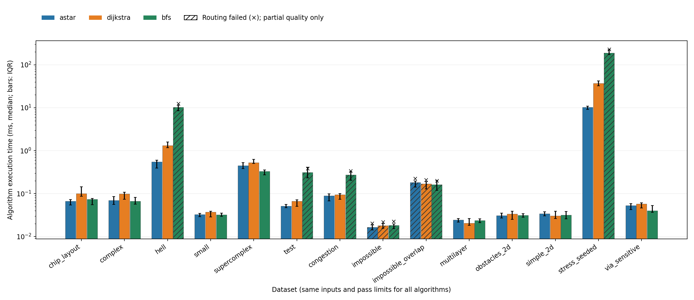
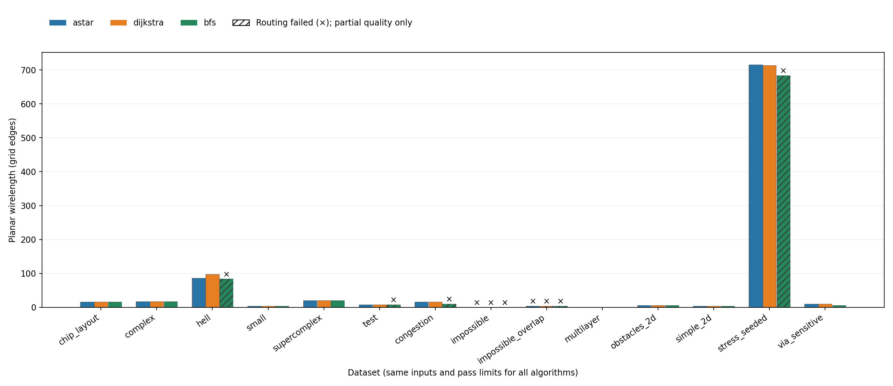
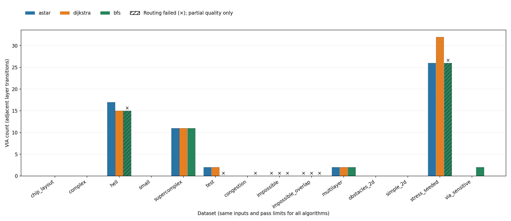
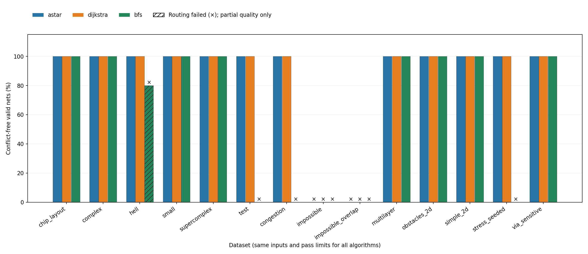
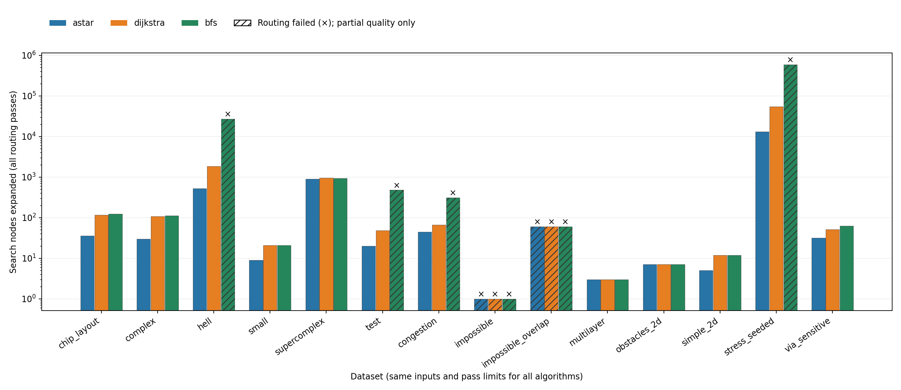

# Independent Technical Project — VLSI Routing and Algorithm Evaluation

The measurements below document commit `62022a0`, before BFS early termination.
They remain historical evidence with their original source/executable hashes.
The subsequent early-stop snapshot is preserved in the [update notes](early_stop/NOTES.md)
and [its archived measurements](early_stop/RESULTS.md). The latest
[engineering audit](../docs/ENGINEERING_AUDIT.md) adds CI, stricter validation,
build provenance, and the separate [robustness/order experiment](ROBUSTNESS.md).
The historical commands below describe that old source snapshot. The current
runner refuses existing result directories; use the fresh-output commands in the
README to keep historical suites intact.

This is an undergraduate independent engineering project and technical report,
not a peer-reviewed paper, faculty-supervised study, or industrial routing tool.
A*, breadth-first search (BFS), Dijkstra's algorithm, and rip-up/reroute are
established methods. The contribution here is their implementation, explicit
routing constraints, correctness checks, reproducible experiments, and analysis.

## 1. Problem Definition

Given a finite grid, blocked cells, and two-pin nets, connect each source to its
target using orthogonal moves. A solution is successful only when **every** net
has a legal path and no cell belongs to two different nets. A shorter collection
of overlapping paths is not a valid solution. This project studies correctness,
search effort, route geometry, and a simple multi-net congestion heuristic.

## 2. Grid Model and Routing Constraints

Cells are indexed `(z, x, y)` = (layer, row, column). Each cell has capacity one.
Neighbors differ by exactly one in exactly one coordinate. Obstacles are blocked
on their specified layer; a different layer at the same row/column is independent.
A net may use its own endpoint cells but no other net's pins. Paths cannot repeat
cells. Layer transitions consume both endpoint cells and one VIA per adjacent
layer crossed. Two nets cannot share a VIA endpoint. Same-layer edge crossings
on this integer grid necessarily share a cell; no separate continuous geometry
is modeled.

The physical layout is immutable. Validation rebuilds cell-to-net ownership from
complete ordered paths, independently of the search's occupancy counters. It
checks endpoints, bounds, adjacency, obstacles, other pins, self-repetition, and
inter-net overlap. Display symbols never determine correctness.

Inputs accept `rows cols` or `layers rows cols`, then exactly the declared number
of rows with the declared number of tokens. Blank lines between rows are allowed.
Tokens are `.`, `#`, `S<number>`, and `T<number>`. IDs need not be consecutive, but
each must have exactly one source and target. Empty netlists and malformed inputs
are errors. The two short rows in original datasets were explicitly repaired;
see [audit and coordinates](../docs/AUDIT.md). Results refer to these repaired
inputs, not to the original parser's shifted interpretation.

## 3. A* Routing Method

A* orders its priority queue by `f = g + h`. With planar cost 1 and layer-step
cost 6, the heuristic is

\[
h(p,t)=|x_p-x_t|+|y_p-y_t|+6|z_p-z_t|.
\]

Every route must pay at least these axis displacement costs. Each legal edge
reduces this bound by at most its base cost; congestion/history additions are
nonnegative. Thus the heuristic is admissible and consistent for a **fixed
single-net search context**. A* terminates when the destination is removed with
its current best score. Outdated queue entries are skipped. Equal `f` values use
insertion order; neighbor order is `-x,+x,-y,+y,-z,+z`. Reconstruction has bounds
and cycle guards and returns source-to-target order.

This argument does not establish global optimality of sequential multi-net
routing or convergence of rip-up/reroute. The automated tests compare A* and
Dijkstra against a separately implemented Bellman–Ford oracle on 200 seeded tiny
graphs with nonzero occupancy and historical costs, including unreachable cases.

## 4. BFS and Dijkstra Baselines

Dijkstra uses the same weighted search machinery and cost function as A*, with
`h = 0`. This controls implementation differences while exposing the effect of
the heuristic. BFS uses a FIFO queue and minimizes the number of graph edges.
It deliberately ignores all edge weights while selecting a path. Its resulting
path is subsequently evaluated with the same physical cost and validity rules.
All three obey identical obstacle/pin constraints and may temporarily overlap
existing routes during negotiation; final overlaps are always prohibited.

All algorithms receive identical layout bytes, numeric net ordering, neighbor
order, and pass limits. Their earlier path choices can differ, producing different
occupancy for later nets even under the same driver. Therefore equal single-net
optimal costs do not imply equal aggregate multi-net costs. Results include a
separate one-pass experiment to distinguish search behavior from repeated passes.

## 5. VIA and Congestion Cost Models

For a move from `u` into `v` during pass `k`, weighted search uses

\[
c_k(u,v)=1+5\mathbf{1}[z_u\ne z_v]
 +100\mathbf{1}[O_k(v)>0]+H_k(v).
\]

`O` counts earlier nets occupying that cell in the current pass. The occupancy
penalty is charged once per occupied destination cell, not per occupant. `H` is
history from previous passes. The starting cell is not charged because no edge
enters it. The constants are illustrative units, not calibrated manufacturing,
electrical, or process costs.

The final physical quality measure is `C = W + 6V`, where `W` counts planar
edges and `V` counts layer-changing edges. Graph length is `L = W + V`, so
`C = L + 5V`. `search_cost` additionally includes the occupancy/history actually
charged when each final-pass path was selected. Its components depend on order
and pass history; it is not a stable cross-run quality objective. For example,
the congestion case can end conflict-free while still paying historical costs.

## 6. Rip-up and Reroute Strategy

Each pass clears all occupancy and routes nets in increasing numeric ID order.
It retains physical pins/obstacles and the history grid. After the pass, the
independent validator counts owners at every cell. Each shared cell receives
`H(v) += 50` before another pass. Success ends the run. A pass with no conflicts
also ends the run even if a net is unreachable: soft occupancy does not block
reachability, so repeating unchanged physical constraints cannot connect it.
Otherwise the driver stops at the requested pass limit (default 10).

This preserves the original full-rip-up strategy, with explicit ownership
replacing symbol-based detection. It is a heuristic: no convergence guarantee,
net-order optimization, best-pass retention, or proof of global infeasibility is
provided. BFS ignores history and occupancy weights, so fixed-order reruns repeat
its paths. Its default ten-pass runtime on conflicted cases includes this known
limitation; it must not be interpreted as ten times slower single-net searching.

## 7. Experimental Setup

The recorded environment is macOS 13.7.8, x86_64, four reported logical CPUs,
Apple Clang 14.0.3, Python 3.10.11, C++17, `-O2 -Wall -Wextra -Wpedantic`.
The CPU model was not available through the sandbox's system query. Exact compiler
output, platform, commands, input/source/executable SHA-256 hashes, and timestamp
are in [metadata.json](metadata.json). No CPU affinity or frequency control was
applied. These are local measurements on one machine; small runtimes are noisy.

Fourteen inputs comprise the six existing layouts plus eight documented
[generated scenarios](layouts/README.md). The larger generated layout has 6,400
cells and 12 nets, with obstacle seed `20261016`. Seeds were not selected to
favor an algorithm. Generation is separate from execution.

For each of the 42 input/algorithm pairs, the harness performs one excluded
warm-up invocation, then 20 measured fresh-process invocations. Within each
repetition, job order is shuffled with seed `20261016`. Warm-ups do not warm the
new process's internal caches; they mainly exercise the executable and filesystem.
The algorithm timer excludes process startup. Each serialized result is checked
against its source layout by independent Python code, and all non-timing outputs
must agree across repetitions. Return code 2 is a recorded routing failure,
not a harness error. Crashes, timeouts, malformed output, or validation mismatch
are recorded as execution errors with missing metrics, never synthesized values.

The main suite records 840 observations at a maximum of 10 passes. A supplemental
840-observation [one-pass suite](single_pass/RESULTS.md) uses `--max-iterations 1`
and the same inputs and 20 repetitions. Runs were performed sequentially after
compilation/sanitizer checks, without another project benchmark running alongside.
The harness's failure-recording path is itself tested using an executable that
always exits with an error.

Reproduce from the repository root:

```sh
make
make test PYTHON=.venv/bin/python
make sanitize
.venv/bin/python benchmarks/generate_layouts.py
.venv/bin/python benchmarks/run_benchmarks.py --repetitions 20
.venv/bin/python benchmarks/run_benchmarks.py --repetitions 20 --max-iterations 1 --results-dir benchmarks/single_pass
./router --input data/chip_layout_hell.txt --algorithm astar --output output.json
.venv/bin/python benchmarks/validate_output.py --input data/chip_layout_hell.txt --output output.json
.venv/bin/python benchmarks/plot_results.py
.venv/bin/python benchmarks/plot_results.py --csv benchmarks/single_pass/results.csv --output-dir benchmarks/single_pass/figures
.venv/bin/python visualize.py --input output.json --html benchmarks/figures/routing_example.html --no-show
```

Dependency/environment setup is in the [README](../README.md). Route JSON files
for every invocation are generated under each suite's ignored `routes/` folder;
CSV, metadata, and figures are retained. Regeneration replaces local measurements.

## 8. Evaluation Metrics

| JSON / CSV field | Definition |
|---|---|
| `total_nets` | Number of validated source/target pairs |
| `routed_nets` | Nets with a locally legal, nonempty path and no shared cells |
| `success_rate` | `routed_nets / total_nets`, a fraction in JSON/CSV, percent in plots |
| `unrouted_nets` | Nets with an empty path; conflicted paths are separately identifiable |
| `invalid_nets` | Nonempty paths failing local geometry/pin checks, excluding mere inter-net overlaps |
| `unresolved_conflicts` | Distinct cells with at least two different net owners, not pairwise intersections |
| `wirelength` | Sum of planar edges over locally legal final paths |
| `via_count` | Sum of adjacent layer transitions over locally legal final paths, including endpoints |
| `graph_steps` | `wirelength + via_count` |
| `weighted_cost` | Physical cost `wirelength + 6 * via_count` |
| `search_cost` | Sum of weighted costs at the time final-pass paths were searched, including temporary penalties |
| `routing_passes` | Number of complete routing passes, including the initial attempt |
| `reroute_iterations` | `routing_passes - 1`; CLI max-iterations bounds total passes for legacy consistency |
| `runtime_ms` | `steady_clock` elapsed milliseconds around allocation, searches, occupancy, validation, and history updates; excludes parsing, JSON, console, and plotting |
| `nodes_expanded` | Non-stale priority-queue removals (or BFS queue removals), including each reached goal, summed over all searches/passes |
| `success` | Boolean: every required net is valid and conflict-free |
| `process_wall_ms` | Harness wall time including process startup and I/O; diagnostic only, not plotted algorithm time |

Geometry totals include locally legal paths involved in conflicts. On failed runs
these are partial/candidate-route statistics, **not** quality scores for a valid
solution. An unreachable layout can have cost zero and still be a complete
failure. Empty, invalid, and overlapping nets are not conflated with successful
nets. `summary.csv` reports runtime median, mean, sample standard deviation
(`n-1` denominator), minimum, and maximum. Plotted timing bars show medians and
interquartile ranges. Runtime repetition estimates system variation, not
variation across independent circuit designs.

## 9. Benchmark Results

| Dataset | Algorithm | Valid nets | Wire | VIAs | Physical cost | Median ms | Expanded |
|---|---|---:|---:|---:|---:|---:|---:|
| `chip_layout_hell` | astar | 10/10 | 86 | 17 | 188 | 0.550117 | 528 |
| `chip_layout_hell` | dijkstra | 10/10 | 98 | 15 | 188 | 1.318910 | 1,857 |
| `chip_layout_hell` | bfs | 8/10 | 84 | 15 | 174 † | 10.241392 | 26,890 |
| `via_sensitive` | astar | 1/1 | 10 | 0 | 10 | 0.052457 | 32 |
| `via_sensitive` | dijkstra | 1/1 | 10 | 0 | 10 | 0.057272 | 51 |
| `via_sensitive` | bfs | 1/1 | 6 | 2 | 18 | 0.040226 | 63 |
| `congestion` | astar | 2/2 | 16 | 0 | 16 | 0.089675 | 45 |
| `congestion` | dijkstra | 2/2 | 16 | 0 | 16 | 0.094829 | 66 |
| `congestion` | bfs | 0/2 | 10 | 0 | 10 † | 0.273263 | 310 |
| `stress_seeded` | astar | 12/12 | 716 | 26 | 872 | 10.258510 | 13,257 |
| `stress_seeded` | dijkstra | 12/12 | 714 | 32 | 906 | 37.030697 | 54,701 |
| `stress_seeded` | bfs | 0/12 | 684 | 26 | 840 † | 188.334152 | 589,700 |

† Failed routing: candidate-path cost, not a feasible solution.

The [complete results table](RESULTS.md), [raw observations](results.csv), and
[summary statistics](summary.csv) include all instances and failures. Each
input/algorithm pair has 20 independently checked observations. There were zero
execution or output-validation errors in the recorded suites. A* and Dijkstra
complete 12 of 14 main-suite instances; BFS completes 8 of 14. Both deliberately
impossible instances fail for every algorithm.







Hatching and crosses indicate routing failure, including zero-height bars.
Failed observations remain in runtime statistics. The one-pass results are
reported separately and must not be mixed into the ten-pass distribution.

## 10. Analysis and Discussion

On `chip_layout_hell`, A* and Dijkstra both produce cost 188 with 10/10 valid
nets, but choose different equal-cost geometry: A* uses 86 planar edges and 17
VIAs; Dijkstra uses 98 planar edges and 15 VIAs. A* expands 528 nodes versus
1,857 for Dijkstra. BFS has 8/10 conflict-free nets and one shared cell, so its
lower candidate cost 174 cannot be presented as a better feasible solution.

The VIA-sensitive instance isolates the objective difference: BFS chooses
6 planar edges plus 2 VIAs (8 graph edges, cost 18); both weighted algorithms
choose 10 planar edges and no VIAs (10 graph edges, cost 10). All succeed.
BFS is correct for its objective, and A* is correct for a different objective.

On the congestion fixture, weighted routing needs two passes. The first net's
short path occupies the second net's required cell. Historical cost moves the
first net to a longer detour, producing two valid paths and physical cost 16.
BFS repeats the original conflict because it does not consume weighted history.
The one-pass experiment exposes this first-pass failure for all three methods.

The stress fixture yields costs 872 (A*) and 906 (Dijkstra), with both routing all
12 nets. This is **not** evidence that A* finds a better shortest path than
Dijkstra: early equal-cost choices alter occupancy for later nets. Neither
algorithm globally optimizes the multi-net solution. A* expands 13,257 nodes
versus 54,701 for Dijkstra in that run. BFS's 79 shared cells invalidate the result.

In the one-pass suite, hell-layout medians are 0.497615 ms (A*), 1.170510 ms (Dijkstra), and 0.869641 ms (BFS). BFS still has one conflict, but its expanded count is 2,689 rather than 26,890. On the stress case, one-pass medians are 10.251588, 38.050642, and 17.583351 ms respectively; BFS still fails. Conversely, BFS completes `chip_layout_supercomplex` with the same cost 86 and has a main-suite median of 0.331334 ms, below both weighted algorithms on this machine. This is a concrete counterexample to an unconditional A*-is-faster claim.

The disconnected instance fails because no physical path exists. The crossed
single-cell fixture fails because both paths require the same cell. Those
infeasibility explanations follow directly from the constructed layouts. Failure
on an arbitrary layout is only a failure of this heuristic within its budget,
not proof of infeasibility. Across simple instances, initialization, validation,
and queue overhead can dominate; fewer expanded nodes do not guarantee a faster
measured run. Timing uncertainty is visible in mean/standard-deviation values.

Correctness checks passed: 13 C++ test groups (including 200 oracle comparisons),
6 Python integration tests, and the C++ tests under AddressSanitizer and
UndefinedBehaviorSanitizer. All original layouts were exercised with all three
algorithms. Plotly figure construction and self-contained HTML export were
executed for successful, empty, and conflicted outputs. Browser interaction was
not manually tested. No functional tests failed or were skipped in the recorded
virtual environment.

## 11. Limitations

This is a discrete educational model, not industrial global or detailed routing.
It lacks multi-terminal nets, real placement/technology input formats, wire width,
spacing/enclosure rules, preferred layer directions, blockages with fractional
capacity, timing and parasitics, crosstalk, antenna rules, via stacks/enclosures,
and manufacturing design-rule checks. A conflict-free result is valid only under
the stated cell model, not a manufacturable layout.

The full-rip-up heuristic uses fixed net order and empirical cost constants,
recomputes whole searches, and can oscillate or exhaust its pass budget. There is
no memory/peak-RSS measurement or congestion-parameter sensitivity study. BFS
cannot respond to weighted history. All searches and validators allocate work
proportional to grid size; this is not optimized for large industrial inputs.
The C++ validator and Python checker share the stated specification, so their
agreement is evidence, not a formal proof.

The dataset family is small and synthetic, includes repaired legacy inputs,
and uses only one random stress seed. Repeated timings on one machine do not
establish universal performance or statistical generalization across VLSI
circuits. No performance comparison with the original implementation is claimed:
its success checks, inputs, and timing boundaries were not comparable.

## 12. Future Improvements

Evaluate more independently generated instances and seeds; report paired runtime
and search-effort distributions across designs. Explore net-order policies,
selective rip-up, best-pass retention, and explicit stagnation detection. Add
controlled experiments for VIA/occupancy/history weights. Extend to multi-pin
nets, layer-specific direction/capacity constraints, and meaningful geometric
design rules before considering physical-design integration. Keep route validation
independent as these constraints evolve.
