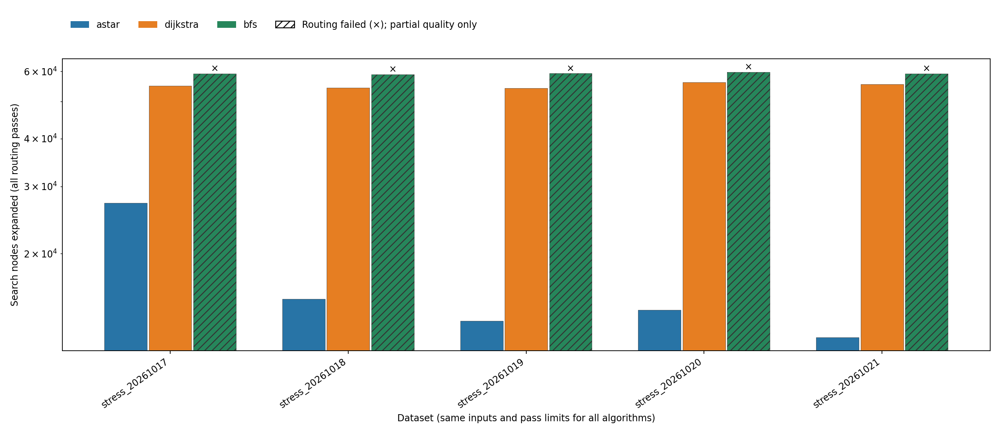
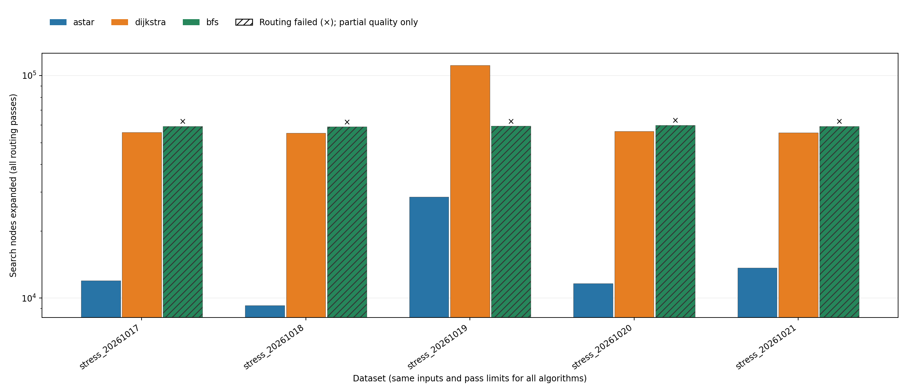

# Independent-layout and net-order experiment

## VERIFIED — Setup

Five obstacle seeds were fixed in advance: 20261017, 20261018, 20261019,
20261020, and 20261021. Each creates a 4 × 40 × 40 grid with 12 two-pin nets,
obstacle probability 0.18, and the same endpoint coordinates as the original
stress fixture. Endpoint placement overrides obstacles. No seed was filtered
based on success. [Generation metadata](robustness/layouts/generation.json)
records the exact input hashes; generation is separate from execution.

Each identical input is tested with A*, Dijkstra, and BFS under numeric and
reverse net order. All other routing parameters remain unchanged: planar cost 1,
VIA cost 6, occupancy penalty 100, history increment 50, and at most ten passes.
Reverse changes search scheduling only. Net IDs, source/target identities, output
ordering, and the independent validation rules remain unchanged.

There are **150 measured runs**: 5 layouts × 3 algorithms × 2 orders × 5
repetitions, plus 30 excluded warm-ups. Algorithm job order is shuffled within
repetitions with a recorded seed. Numeric and reverse suites run sequentially;
this is not an interleaved paired timing experiment. Each measured output is
independently checked, and all non-timing fields repeat exactly within its pair.

Environment: macOS x86_64, Apple Clang 14.0.3, Python 3.10.11, C++17 with `-O2
-Wall -Wextra -Wpedantic`. Exact build commands, executable/source/input hashes,
Git base and dirty state are in the per-suite metadata. The Git SHA alone does
not identify this uncommitted source snapshot; the SHA-256 records do.

## VERIFIED — Results

Both weighted algorithms succeed on **5/5 independent layouts** with either
order. BFS succeeds on **0/5** with either order. Across measured invocations,
there are 100 complete routing successes and 50 correctly reported routing
failures, with **zero execution errors, validation errors, or locally invalid
paths**. The failures retain conflicts, partial validity, and candidate costs.

Physical costs for successful weighted solutions, numeric → reverse:

- Seed 20261017: A* 876 → 880; Dijkstra 950 → 874.
- Seed 20261018: A* 874 → 838; Dijkstra 862 → 856.
- Seed 20261019: A* 880 → 882; Dijkstra 874 → 876.
- Seed 20261020: A* 916 → 860; Dijkstra 918 → 878.
- Seed 20261021: A* 858 → 902; Dijkstra 898 → 888.

For A* on seed 20261017, reversing order reduces passes from two to one and
expanded nodes from 27,118 to 11,969, but slightly increases physical cost.
On seed 20261019 it increases passes from one to two for both weighted methods;
A* expansions rise from 13,339 to 28,487, and Dijkstra from 54,258 to 111,313.
These are deterministic work counts, not claims based on timing noise.

BFS geometry and expanded nodes are unchanged by reversing order, as expected
from its occupancy-insensitive objective. Its final search-cost accounting may
change because that metric evaluates occupancy at each net's search time.
Across the five seeds it leaves 61–103 conflicting cells and only 0–1 of 12 nets
globally valid. Its lower candidate costs must not be ranked as feasible wins.

The complete per-layout measurements, including wirelength, VIAs, success,
conflicts, costs, expanded nodes, passes, runtime median/mean/sample deviation,
and sample counts are retained separately:

- Numeric: [raw CSV](robustness/numeric/results.csv), [summary](robustness/numeric/summary.csv),
  [results](robustness/numeric/RESULTS.md), [metadata](robustness/numeric/metadata.json).
- Reverse: [raw CSV](robustness/reverse/results.csv), [summary](robustness/reverse/summary.csv),
  [results](robustness/reverse/RESULTS.md), [metadata](robustness/reverse/metadata.json).




Five PNG plots per order were generated from these CSVs; failed observations are
hatched and marked. SVG duplicates and unrelated representative-route images were
not added to this experiment.

## VERIFIED — Interpretation

Earlier nets create occupancy penalties for later searches. Changing that order
can change both the initial geometry and which cells collect historical cost.
Numeric order is simple and reproducible, but privileges lower-numbered nets.
Reverse is an experimental alternative, not a new optimization algorithm.
Neither order dominates these five examples. A* and Dijkstra can differ in
aggregate physical cost because early equal-cost choices produce different
contexts for later nets; their fixed-context weighted objectives remain equal.

## REMAINING LIMITATION — Scope

Only five independent obstacle realizations were added, all with one grid size,
pin arrangement, and obstacle probability. Five timing repetitions per pair
estimate local runtime variation; they do not turn five layouts into 25 independent
layouts. No hypothesis test, statistical-significance claim, or generalization to
industrial designs is made. Runtime distributions from different sessions should
not be treated as controlled speedup measurements. Rerouting may oscillate or
reach its cap; identical weighted paths in consecutive passes are not by
themselves a safe stagnation criterion because history continues to change.

## VERIFIED — Reproduction commands

Run from the repository root after installing the README's plotting dependencies.
Use fresh result directories; the runner refuses to overwrite recorded evidence.

```sh
make
python3 benchmarks/generate_robustness.py
set --
for layout in benchmarks/robustness/layouts/*.txt; do
  set -- "$@" --input "$layout"
done
python3 benchmarks/run_benchmarks.py --skip-build --repetitions 5 --net-order numeric --results-dir build/robustness-numeric "$@"
python3 benchmarks/run_benchmarks.py --skip-build --repetitions 5 --net-order reverse --results-dir build/robustness-reverse "$@"
.venv/bin/python benchmarks/plot_results.py --csv build/robustness-numeric/results.csv --output-dir build/robustness-numeric/figures --format png
.venv/bin/python benchmarks/plot_results.py --csv build/robustness-reverse/results.csv --output-dir build/robustness-reverse/figures --format png
python3 benchmarks/verify_evidence.py --suite build/robustness-numeric --suite build/robustness-reverse
```

Plot regeneration writes its requested figure/report destinations. When reading
an archived CSV, specify a fresh `--output-dir` and `--report` to preserve its
original plots and Markdown. Archived suites and original datasets remain
byte-for-byte unchanged by this audit.
